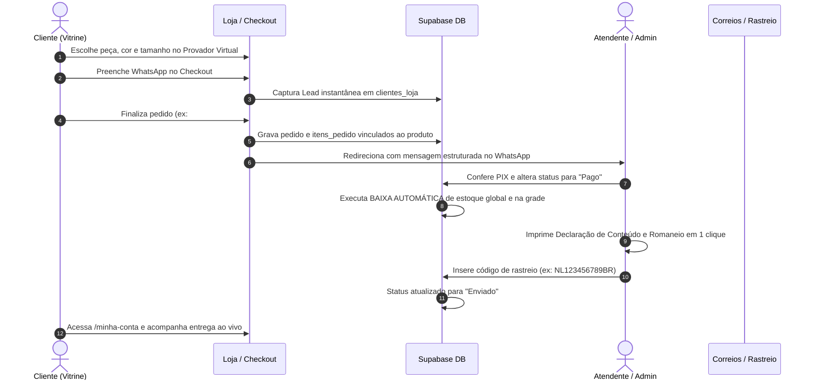

# 📖 MANUAL OPERACIONAL & RELATÓRIO DE INTEGRAÇÃO ADMIN <-> VITRINE
*BCOMM Shop — Plataforma de E-commerce de Moda Feminina e Gestão Omnichannel*
*Data de Homologação: 17 de Outubro de 2026*

---

## 1. 🎯 OBJETIVO E VISÃO GERAL
Este manual reúne o funcionamento completo da integração entre a **Vitrine da Loja** e o **Painel Administrativo do Lojista**, servindo como guia prático para a dona da boutique, equipe de atendimento, expedição e novos operadores.

---

## 2. 🔄 FLUXO OPERACIONAL DE UMA VENDA (PASSO A PASSO)

---

## 3. 🛠️ GUIA DE USO DAS FUNCIONALIDADES

### 3.1 Central de Pedidos (`/admin/pedidos/`)
- **Filtros Rápidos:** Navegue entre *Todos*, *Pagos*, *Em Separação*, *Enviados*, *Aguardando WhatsApp* e *Cancelados*.
- **Atualização de Status com Controle de Estoque:**
  - Marcar como **`pago`**: O sistema baixa as unidades vendidas do saldo global e da combinação específica de cor e tamanho.
  - Marcar como **`cancelado`**: O sistema reverte e estorna as peças de volta para a grade da loja.
- **Botão de Expedição em 1 Clique:**
  - Clique em **"Expedição"** no pedido desejado.
  - Escolha entre:
    1. **Declaração de Conteúdo Oficial (Correios):** Já preenchida com Remetente, Destinatário, CPF, endereço completo, discriminação de itens, valores e texto legal da Portaria dos Correios.
    2. **Romaneio de Separação (Packing List):** Checklist com peças a separar no estoque, tamanhos, cores e checklist de qualidade da boutique (passadoria, perfume da loja, laço de cetim e cartão assinado).
  - Clique em **"Imprimir Agora (A4)"** para enviar direto para a impressora.
- **Snippets Rápidos de WhatsApp:**
  - Clique na setinha ao lado do botão **WhatsApp** para escolher mensagens prontas:
    1. *Atendimento Geral:* Tira-dúvidas e suporte.
    2. *Chave Pix & Reserva:* Envia o valor e a chave Pix da loja.
    3. *Aviso de Rastreio:* Envia o código dos Correios e link de consulta.
    4. *Pós-Venda Carinhoso:* Envia mensagem perguntando sobre o caimento no corpo.

---

### 3.2 Gestão de Peças & Catálogo (`/admin/produtos/`)
- **Cadastro Completo:**
  - Nome, descrição, tecido (*Tricot Biamar, Linho, Seda*), modelagem e coleção.
  - Preço de Venda, Preço Promocional e **Preço de Custo (CMV)** para cálculo de margem real.
  - Upload de fotos e vídeos de provador verticais 9:16 direto no **Cloudflare R2** com entrega via CDN sem custo de tráfego.
  - Grade dinâmica de cores (com código HEX) e tamanhos (PP, P, M, G, GG, Único) com saldo individual por peça.
- **Pausar / Ativar Peça:**
  - Botão com ícone de olho para pausar temporariamente a peça da vitrine sem deletar o histórico contábil.
- **Edição Rápida:**
  - Reajuste de preços e estoque global em modal rápido sem precisar abrir o formulário inteiro.

---

### 3.3 CRM de Clientes & Recuperação de Carrinhos (`/admin/clientes/`)
- **Identificação Automática:**
  - Clientes VIP (gastos acumulados superiores a R$ 500 ou 3+ pedidos).
  - Clientes Recorrentes (2+ pedidos).
  - Novas Compradoras (1 pedido).
  - **Leads & Carrinho Abandonado (0 pedidos):** Pessoas que preencheram o WhatsApp no checkout mas não concluíram o pagamento.
- **Recuperação em 1 Clique:**
  - Ao filtrar pela aba **"Leads & Carrinho Abandonado"**, o botão muda para **"Recuperar Carrinho"** com mensagem gentil e acolhedora pronta para o WhatsApp.

---

### 3.4 DRE Financeiro & Lucro Real (`/admin/financas/`)
- Exibe o DRE Gerencial ao vivo:
  - **Faturamento Bruto:** Soma dos pedidos faturados no período selecionado (*Hoje, 7 Dias, Mês, Todo o Período*).
  - **CMV (Custo das Mercadorias):** Baseado no preço de custo cadastrado em cada peça.
  - **Despesas Operacionais:** Taxa de cartão padrão (3,5%) e custo médio de embalagem de luxo (R$ 8,00 por envio).
  - **Lucro Líquido Real:** O valor real que sobra líquido no caixa da loja após custos e despesas.
  - **Margem Líquida %:** Percentual de lucro real sobre o faturamento.

---

### 3.5 Identidade Visual & Paleta de Cores (`/admin/configuracoes/`)
- Seleção de paletas pré-configuradas (*Dourado Imperial, Rose Gold Chic, Esmeralda Nobre, Burgundy Sofisticado, Preto Minimalista*).
- O tema é persistido e aplicado dinamicamente em todo o layout do painel administrativo.

---

## 4. 🔒 SEGURANÇA E INTEGRIDADE DE DADOS
- **RLS (Row Level Security):** Todas as tabelas do Supabase possuem políticas que isolam rigorosamente os dados de cada loja (`loja_id`). Nenhuma loja consegue visualizar produtos, clientes ou pedidos de outra loja.
- **Soft-Delete Seguro:** Produtos que já possuem histórico de vendas não podem ser excluídos fisicamente do banco de dados para não corromper o histórico fiscal e os relatórios de pedidos antigos; eles são arquivados automaticamente.
- **Compatibilidade UUID:** O sistema resolve automaticamente identificadores em formato slug para os UUIDs canônicos das tabelas do banco, garantindo integridade referencial.
